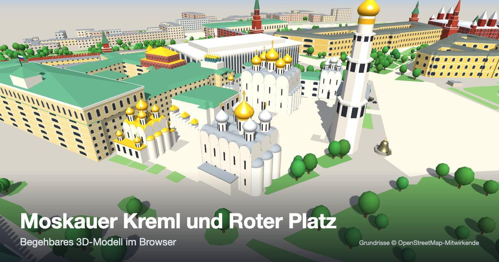

# Moskauer Kreml und Roter Platz in 3D

Begehbare 3D-Szene im Browser (Three.js) auf Grundrissen aus OpenStreetMap.

**Live:** https://helmutqualtinger.github.io/Kreml/



## Inhalt

- **Kathedralenplatz:** Mariä-Entschlafens-, Erzengel-Michael- und Mariä-Verkündigungs-Kathedrale, Gewandniederlegungskirche, Zwölf-Apostel-Kirche, Glockenturm Iwan der Große, Facettenpalast, Zarenglocke, Zarenkanone
- **Kreml:** Großer Kremlpalast mit Terem-Palast, Senatspalast, Arsenal, Staatlicher Kremlpalast, Rüstkammer, Lustpalast, Patriarchenpalast, Kremlmauer mit allen 20 Türmen
- **Roter Platz und Umgebung:** Basilius-Kathedrale, Lenin-Mausoleum, GUM, Historisches Museum, Kasaner Kathedrale, Auferstehungstor, Lobnoje Mesto, Manege, umliegende Stadtgebäude, Moskwa
- **Figuren:** zwei stilisierte Figuren (Putin, Selenskyj) und ein oben offener Käfig (5 × 5 m, 4 m hoch) in der Mitte des Kathedralenplatzes; die zweite Figur geht im Käfig auf und ab, die erste tanzt im Takt der Musik Kasatschok um den Käfig (Schalter „Kasatschok“; ein Klick auf ein Ziel beendet den Tanz)
- **Musik:** der Refrain von „Kalinka“ (Iwan Larionow, 1860), im Browser mit Web Audio erzeugt; startet mit der ersten Eingabe, Schalter „Musik“

Lage, Umriss und Ausrichtung der Gebäude stammen aus OpenStreetMap. Die Baukörper sind vereinfachte Modelle, Höhen sind teils geschätzt, das Gelände ist flach. Käfig und Figuren sind frei hinzugefügt.

## Bedienung

| Aktion | Wirkung |
|---|---|
| Klick auf Boden oder Gebäude | Gewählte Figur geht dorthin; bei Gebäuden erscheint eine Infokarte |
| Klick auf eine Figur, Knopf „Figur: …“ | Figur wählen; die Kamera folgt ihr |
| Ziehen | Kamera drehen |
| Mausrad, Zwei-Finger-Geste | Zoom |
| Ortsliste | Gewählte Figur geht zum Ort |
| „Schnell gehen“ | Dreifaches Tempo |
| „Beschriftung“ | Namensschilder ein/aus |

Die frei bewegliche Figur verlässt den Kreml durch Erlöser-, Nikolaus- und Borowizki-Tor. Die Figur im Käfig bewegt sich nur innerhalb der Stäbe.

## Lokal starten

`index.html` im Browser öffnen. Three.js wird von einem CDN geladen, es ist also eine Internetverbindung nötig. `index.html` und `kreml-data.js` müssen im selben Ordner liegen.

## Dateien

| Datei | Inhalt |
|---|---|
| `index.html` | Szene, Gebäudemodelle, Figuren, Wegsuche |
| `kreml-data.js` | Grundrisse in lokalen Meterkoordinaten (erzeugt, nicht von Hand ändern) |
| `tools/build_data.py` | Erzeugt `kreml-data.js` aus den OSM-Rohdaten |
| `osm/kreml.json`, `osm/extra.json` | Overpass-Abzüge (Gebäude, Mauern, Wasser; Parks, Plätze, Gebäudeteile) |
| `preview.png` | Vorschaubild für soziale Medien (1200 × 630) |

## Daten neu erzeugen

```bash
python3 tools/build_data.py osm/kreml.json osm/extra.json kreml-data.js
```

## Prüfansichten

- `index.html#map` zeigt das Wegenetz (weiß erreichbar, orange unerreichbar, dunkel gesperrt).
- `index.html#cam=x,z,yaw,pitch,dist` setzt Figur und Kamera.

## Lizenz der Daten

Grundrisse © OpenStreetMap-Mitwirkende (ODbL).
